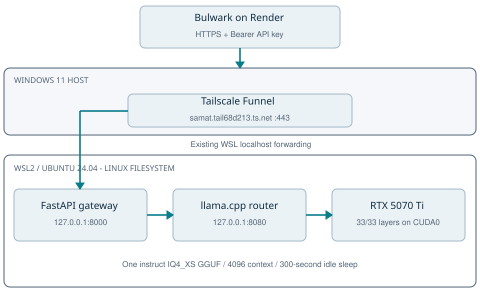
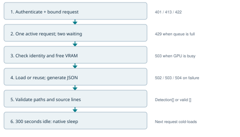

# Bulwark Local AI Deployment Guide

## 1. Executive Summary

Bulwark now has an authenticated source-code review API on this Windows 11 laptop. A lightweight FastAPI gateway in WSL2 routes accepted work to Foundation-Sec-8B-Instruct IQ4_XS through a private CUDA llama.cpp router. Source content is data and is never executed.

The deployed HTTPS base address is https://samat.tail68d213.ts.net . The model starts unloaded, loads on demand and unloads weights and KV cache after 300 seconds without inference. Local inference avoids a permanently allocated cloud GPU and keeps source processing on this machine after HTTPS ingress.

**Verified on 15 November 2026:** 28 gateway tests, @@COUNT@@ live lifecycle checks, Windows localhost, authenticated public Funnel ingress, cold loading, warm reuse, simultaneous cold requests, idle release and reload. Both systemd user services are active and enabled. Handoff model state: @@STATE@@.

The project is /home/samat_zharassov/cyber-model. The local deployment was kept separate. The user-authorized PR publishes only this secure API package and its usage guide in hunterh37/Bulwark. Existing cloud backend code and dependencies are unchanged. A caller must add the Bearer header and configure Render variables to use the API. Render settings were not changed. This is a measured local deployment, not a production-readiness certification.

### Compatibility decision

Build 10819 does not implement --models-memory-margin. Its actual help and pinned source were checked. This deployment instead enforces a measured @@PROFILE@@ MiB allocation plus 1536 MiB free headroom in the gateway, selects CUDA0 explicitly, disables automatic CPU fitting, and samples headroom during inference. This is a gateway safeguard, not a native router option.

## 2. Architecture

Windows Tailscale terminates public HTTPS and proxies to Windows loopback port 8000. Existing WSL localhost forwarding reaches FastAPI on 127.0.0.1:8000. The private router listens only on 127.0.0.1:8080. Port 8080 is never published. WSL networking mode was not changed.

Authentication precedes body parsing and all model operations. After bounded queue admission, the gateway verifies runtime identity and GPU availability, applies the exact chat template, checks token budget, requests constrained JSON, then validates findings against the original input paths and line numbers.

Health and private model-list checks never call tokenization or generation and do not reset the native idle timer. FastAPI has no public model-administration route and no public chat proxy.

| Location | Responsibility |
|---|---|
| gateway/main.py | Authentication, streamed body limit, queue, cancellation and routes |
| gateway/schemas.py | Strict request/output validation and source bounds |
| gateway/runtime.py | Private router, file identity, GPU admission and guard |
| models/ | Exact instruct IQ4_XS GGUF on the Linux filesystem |
| config/environment | Persistent external key, mode 0600 |
| config/internal-api-key | Separate router key, mode 0600 |
| config/vram-profile.json | Measured allocation and file/configuration digests |
| config/systemd/ | Actual project-owned user unit files; systemd links point here |
| runtime/llama/ | Isolated copy of the compatible existing binary and libraries |
| scripts/ | Setup, operation, calibration, verification and guide generation |
| logs/ | Operational metadata and synthetic verification evidence |
| docs/ | Markdown, PDF, diagrams, provenance and legal notices |

## 3. Hardware and Software

| Component | Observed configuration |
|---|---|
| Host and guest | Windows 11; WSL2 Ubuntu-24.04; Ubuntu 24.04.4 LTS |
| Kernel | 6.18.33.1-microsoft-standard-WSL2 |
| GPU | NVIDIA GeForce RTX 5070 Ti Laptop GPU |
| VRAM | 12227 MiB reported |
| NVIDIA Windows driver | 616.92 |
| CUDA toolkit | 13.3; nvcc V13.3.73 |
| Native target | GGML_CUDA=ON; CMAKE_CUDA_ARCHITECTURES=120 |
| llama.cpp | 0.4.0-dev; build 10819 |
| Commit | 6a1a922d269908a29cbd4b49c27e6a8e7fd10fae |
| Python | 3.12.3, isolated .venv |
| Python packages | @@PACKAGES@@ |
| RAM / disk at audit | About 19 GiB visible RAM, 16 GiB swap, 681 GiB free disk |
| Persistence | systemd running; user lingering enabled |
| Tailscale | Windows 1.104.7; Automatic service; unattended mode |

The driver CUDA capability shown by nvidia-smi is distinct from the installed toolkit version. The existing CUDA installation and original llama.cpp tree were preserved. No Linux display driver was installed. Runtime linkage was verified with the isolated library path; evidence is in logs/runtime-linkage.txt. Exact Python dependency versions are frozen in gateway/requirements.txt.

### Exact model provenance

Repository: https://huggingface.co/gabriellarson/Foundation-Sec-8B-Instruct-GGUF

Revision: @@REV@@

File: Foundation-Sec-8B-Instruct-IQ4_XS.gguf

Size: 4,448,378,112 bytes, approximately 4.45 GB decimal or 4.14 GiB.

Published and locally verified SHA256:

~~~text
@@SHA@@
~~~

The quantizer identifies fdtn-ai/Foundation-Sec-8B-Instruct as its upstream. This is a community GGUF conversion. The checksum confirms the installed file matches the pinned repository object; it is not an independent Cisco publisher signature.

The upstream NOTICE distinguishes Meta's Llama 3.1 Community License from Cisco changes under Apache 2.0. This is not an Apache-only model. The actual texts are retained as docs/fdtn-ai-NOTICE.md, docs/fdtn-ai-LICENSE_LLAMA31.md and docs/fdtn-ai-LICENSE_APACHE2.md. Review applicable use and redistribution terms.

## 4. Model Details

Foundation-Sec-8B-Instruct is Cisco Foundation AI's instruction-tuned cybersecurity model using the Llama 3.1 8B backbone. The upstream configuration records 32 transformer layers, hidden size 4096, 32 attention heads and 8 key/value heads. It advertises 131072 positional embeddings; this deployment deliberately uses only 4096 tokens.

IQ4_XS stores most weights at roughly four-bit precision with quantization metadata and selected tensors at other precision. Its smaller footprint trades numerical precision for local deployability. Neither Q4_K_M nor the non-instruct base model was downloaded.

The model can assist with security explanations and static source review. Domain specialization does not prove vulnerability-detection accuracy. It flagged an intentionally fake placeholder API token in the synthetic test, demonstrating that findings still need engineering review.

| Setting | Deployed value |
|---|---|
| Context / parallelism | 4096 total tokens / 1 sequence |
| Generation | Temperature 0; at most 1024 output tokens |
| GPU | CUDA0; all 33 offloadable layers verified |
| Automatic fitting | off; no silent weight offload reduction |
| Batch / microbatch | 512 / 128 |
| Flash Attention | on |
| KV cache | Default f16; measured 512 MiB |
| Native sleep | 300 seconds |
| Measured CUDA buffers | 3968.40 MiB weights; 512 MiB KV; 28 MiB compute |
| Admission allocation | @@PROFILE@@ MiB, including 512 MiB allowance |
| Additional free headroom | 1536 MiB |

Finding messages are limited to 512 characters. The installed native grammar parser rejected a 2000-character bound. That incompatibility was isolated with real schema requests and corrected before the successful lifecycle test.

## 5. On-Demand Inference

The router starts with exactly one registered model and no resident model worker. First use verifies the installed GGUF and copied runtime hashes before trusting the allocation profile. Later operations check file identities. A changed model, library or launcher requires recalibration and gateway restart.

One operation runs at a time and two may wait. Loading, preflight and generation share this serialization, so simultaneous requests cannot duplicate model loads. Queue waiting is limited to 180 seconds; private HTTP operations allow 240 seconds. Disconnected waiters release capacity. Active disconnected operations are cancelled and their private worker is unloaded before capacity is reused.

### Memory admission

Cold work needs at least @@PROFILE@@ + 1536 MiB free. Warm admission is allowed only when the model currently reports loaded and this gateway has a successful generation dispatched within 240 seconds. Near the 300-second boundary or after gateway restart, the conservative cold reserve applies. A retryable 503 can therefore occur late in an idle interval until native sleep.

During inference the guard queries GPU0 every 0.5 seconds. Lost headroom or failed telemetry unloads only this project's worker. If private unloading cannot be confirmed, a fixed-argument systemd restart of this project's router is the fallback. Unrelated GPU processes are never terminated.

Userspace probes cannot atomically reserve memory against Windows applications. Another program may allocate between samples. This safeguard reduces contention risk; it cannot guarantee that CUDA never encounters it.

### Sleep and wake

Native sleep unloads weights and KV cache after 300 seconds without inference tasks. Health and model-list checks are exempt. Sleep was observed at @@SLEEP_SECONDS@@ seconds with five-second polling. It released @@RELEASED@@ MiB of device-wide usage. The next accepted request reloaded successfully.

## 6. Secure API

Base address: https://samat.tail68d213.ts.net

### GET /healthz

Returns HTTP 200 and {"status":"ok"} without authentication or model loading. It is gateway liveness, not a statement about model readiness, GPU capacity or review accuracy.

### POST /v1/detect

Requires Authorization: Bearer <MODEL_API_KEY> and JSON content. Submitted paths are relative labels and are never opened on disk.

~~~json
{
  "files": [
    {
      "path": "synthetic_config.py",
      "content": "DEBUG = True\nAPI_TOKEN = 'synthetic-placeholder-not-a-real-secret'\n"
    }
  ]
}
~~~

Actual synthetic-test response:

~~~json
@@FINDINGS@@
~~~

A safe addition function returned an actual []. Inference failures are errors, never disguised as clean results.

| Limit / status | Deployed behavior |
|---|---|
| Body | At most 65536 received bytes, including streamed requests |
| Source | 1-32 unique files; total UTF-8 content at most 16000 bytes |
| Paths | Relative POSIX labels, at most 512 characters; traversal and drive prefixes rejected |
| Token budget | Exact template preflight; 1024 output tokens plus 16-token allowance reserved |
| Findings | At most 32; messages at most 512 characters |
| Work | 1 active, 2 waiting; HTTP connection cap 16 |
| 200 | Valid Detection[], including clean [] |
| 401 | Missing or wrong key; no inference |
| 413 / 422 | Input limits / invalid JSON or contract; rejected source not echoed |
| 429 | Queue full or waiting expired |
| 499 | Client disconnected; operation cancelled |
| 502 | Invalid, incomplete or source-inconsistent model response |
| 503 | GPU busy, profile/telemetry unavailable, or engine unavailable |
| 504 | Private inference timeout; own worker unloaded |
| 404 | Unregistered routes, including public model administration |

### Security boundaries

Keys are separate, persistent, generated with secrets.token_urlsafe(48), and protected with mode 0600. Native argv contains a key-file path instead of the key. Uvicorn access logs and proxy-header trust are disabled. The native web UI and production logs are disabled. Gateway logs contain only state, timings, token counts and GPU counters.

No model execution tool exists. The only subprocesses use fixed arguments for nvidia-smi and this project's router service. Prompt injection may affect analysis quality but cannot create a shell capability. Pydantic rejects extra fields and invalid field types; file paths and one-based line numbers must refer to supplied inputs.

Funnel is publicly reachable. Possession of the Bearer key authorizes GPU use. Queue limits are not per-user identity, quotas or comprehensive denial-of-service protection.

## 7. Bulwark Integration

The existing packages/cloud/src/detect/model.ts sends POST to MODEL_URL + "/v1/detect" and expects Detection[]. Its actual severity type accepts critical, high, medium and low. The optional fix field need not be present.

Enabling the shared Render setting routes eligible paths and source from all of its organization scans to this laptop, including private files and .env files. Agree on that routing scope before enabling it. Configure the Render worker:

~~~text
MODEL_URL=https://samat.tail68d213.ts.net
MODEL_API_KEY=<persistent external secret>
~~~

Retrieve the key locally when ready to enter it into Render's secret settings:

~~~bash
cd /home/samat_zharassov/cyber-model
./scripts/retrieve_key.sh
~~~

Do not commit the key or copy it into logs, documents or tickets. Restart or redeploy the worker after changing its environment.

### Required caller-side Authorization header

Keep the existing behavior when MODEL_URL is unset. Add authentication to the existing request:

~~~typescript
const key = process.env.MODEL_API_KEY;
if (!key) throw new Error("MODEL_API_KEY is required");
const res = await fetch(url + "/v1/detect", {
  method: "POST",
  headers: {
    "content-type": "application/json",
    "Authorization": "Bearer " + key,
  },
  body: JSON.stringify({ files }),
  signal: AbortSignal.timeout(450_000),
});
if (!res.ok) throw new Error("model " + res.status);
return (await res.json()) as Detection[];
~~~

For a long-running Node client, configure its HTTP transport timeout as well as the abort deadline; this API-only package does not change backend transport code. The timeout example accommodates cold startup and queuing. Confirm the caller's Render request-duration limits. This API-only PR does not change the backend. Adding this header and configuring Render remain teammate actions.

### Python client

~~~python
import os
import httpx

response = httpx.post(
    os.environ["MODEL_URL"].rstrip("/") + "/v1/detect",
    headers={"Authorization": "Bearer " + os.environ["MODEL_API_KEY"]},
    json={"files": [{"path": "safe.py", "content": "def add(a,b):\n    return a+b\n"}]},
    timeout=450,
)
response.raise_for_status()
detections = response.json()
~~~

## 8. Reproduction Instructions

These are clean-machine instructions using the supplied project sources. They describe additional steps a new machine may need, not installations performed on this already-equipped laptop. Use the pins and rerun calibration for its GPU.

### 8.1 Host, WSL and CUDA

Install an appropriate NVIDIA Windows driver. From an elevated Windows terminal, if WSL is absent:

~~~powershell
wsl --install -d Ubuntu-24.04
wsl --list --verbose
~~~

Complete Ubuntu user creation. Confirm systemd is PID 1. If needed, enable it in /etc/wsl.conf using Microsoft's linked instructions. Existing networking worked here and was not changed.

Configure NVIDIA's official WSL CUDA repository as described in its guide, then install the toolkit and build tools. Do not install a Linux display driver inside WSL.

~~~bash
sudo apt-get update
sudo apt-get install -y build-essential cmake git pkg-config \
  libcurl4-openssl-dev libssl-dev python3-venv python3-dev \
  cuda-toolkit-13-3
/usr/local/cuda-13.3/bin/nvcc --version
/usr/lib/wsl/lib/nvidia-smi
~~~

### 8.2 Project source and Python

Copy gateway/, scripts/, tests/, docs/, config/environment.example, config/systemd/ and pytest.ini from deploy/local-ai in the integration branch to $HOME/cyber-model. Exclude credentials, profiles, .venv and machine-specific logs.

~~~bash
cd "$HOME/cyber-model"
mkdir -p models config logs docs work runtime/llama
python3 -m venv .venv
PIP_CACHE_DIR="$PWD/work/pip-cache" \
  .venv/bin/pip install -r gateway/requirements.txt
.venv/bin/python scripts/init_config.py
chmod 700 scripts/*.sh
~~~

If the Linux username or project path differs, run this Python block from the project directory before installing units:

~~~python
from pathlib import Path
root = Path.cwd()
files = list(Path("scripts").glob("*.sh"))
files += list(Path("config/systemd").glob("*.service"))
for path in files:
    path.write_text(path.read_text().replace(
        "/home/samat_zharassov/cyber-model", str(root)))
~~~

Python runtime paths are derived from source location. init_config.py preserves existing keys.

### 8.3 Pinned CUDA build

This laptop reused its compatible binary. A new single-GPU machine can build the same source:

~~~bash
git clone --no-checkout https://github.com/ggml-org/llama.cpp.git work/llama.cpp
git -C work/llama.cpp checkout 6a1a922d269908a29cbd4b49c27e6a8e7fd10fae
cmake -S work/llama.cpp -B work/llama.cpp/build \
  -DCMAKE_BUILD_TYPE=Release -DGGML_CUDA=ON \
  -DCMAKE_CUDA_ARCHITECTURES=120 \
  -DCMAKE_CUDA_COMPILER=/usr/local/cuda-13.3/bin/nvcc \
  -DGGML_CUDA_NCCL=OFF
cmake --build work/llama.cpp/build --config Release --target llama-server -j4
cp -a work/llama.cpp/build/bin/llama-server runtime/llama/
cp -a work/llama.cpp/build/bin/*.so* runtime/llama/
runtime/llama/llama-server --version
runtime/llama/llama-server --help
runtime/llama/llama-server --list-devices
~~~

The original copied build had NCCL enabled; the clean single-GPU command disables this optional multi-GPU dependency. It is not a byte-identical rebuild. Other GPU architectures need the appropriate CUDA target. Recalibrate every new build.

Inspect supported flags. This deployment uses models-dir, models-max, sleep-idle-seconds, api-key-file, device, gpu-layers, fit and no-webui. It deliberately does not pass the absent models-memory-margin flag.

### 8.4 Exact model and services

Read the retained licenses and check disk space. The downloader checks existing files, pins the repository revision and filename, uses huggingface_hub, and verifies published size and complete SHA256. It downloads no additional model; HF_HOME stays in work/huggingface.

~~~bash
df -h .
.venv/bin/python scripts/download_model.py
cat logs/model-verified.json
./scripts/install_services.sh
sudo loginctl enable-linger "$USER"
./scripts/start.sh
curl --fail http://127.0.0.1:8000/healthz
.venv/bin/python scripts/calibrate.py
.venv/bin/python -m pytest -q
.venv/bin/python scripts/test_e2e.py
./scripts/status.sh
~~~

Calibration is maintenance; choose a quiet period. It blocks new inference, stops the production router, uses authenticated loopback port 8081, tests a 2839-token synthetic prompt with a 1024-token output budget, and filters native trace logs in memory. Telemetry, headroom or offload failures prevent atomic profile publication. The production units are restored afterward.

The unit policy is Restart=on-failure, RestartSec=10, StartLimitIntervalSec=300 and StartLimitBurst=3. It bounds automatic crash restarts. Intentional maintenance and test restarts reset the counters.

Xet stalled during this installation and the HTTP stream slowed. The same partial file was completed with bounded ranges through huggingface_hub and verified in full. One-off transfer evidence is retained in work/resume_download.py and logs/download-resume.log, not offered as a reusable operator command.

### 8.5 Windows and stable HTTPS

Verify Windows localhost forwarding before configuring Funnel:

~~~powershell
Invoke-RestMethod http://127.0.0.1:8000/healthz
winget install --id Tailscale.Tailscale --exact --silent --accept-source-agreements --accept-package-agreements
$ts = "C:\Program Files\Tailscale\tailscale.exe"
& $ts up
& $ts set --unattended=true
& $ts funnel --bg 8000
& $ts funnel status
~~~

Sign in and approve Funnel when account authorization is requested. A new machine receives its own hostname; use the actual output. The current node is samat.tail68d213.ts.net and targets http://127.0.0.1:8000. No inbound firewall opening for 8000/8080 is required. Preserve the node identity and hostname; removing or renaming them may change the URL. Account policy and node-key expiry still need attention.

### 8.6 Persistence, operations and updates

User services start when WSL starts because lingering is enabled. No Windows login task was installed. To start WSL at login, optionally create a Task Scheduler task for this Windows account at logon. Use PowerShell with a hidden window and no execution time limit; its action can run this single-line command:

~~~powershell
Start-Process -WindowStyle Hidden -FilePath wsl.exe -ArgumentList "-d","Ubuntu-24.04","-u","samat_zharassov","--exec","/usr/bin/sleep","infinity"
~~~

The long-lived command keeps an explicit WSL session open. Configure battery and power behavior appropriately. A sleeping or powered-off laptop cannot receive requests.

~~~bash
./scripts/start.sh
./scripts/stop.sh
./scripts/restart.sh
./scripts/status.sh
./scripts/logs.sh
./scripts/check_gpu.sh
~~~

Update during maintenance. Preserve keys; pin and review new model/native versions; rerun checksum verification, calibration and lifecycle tests. Do not reuse an old profile after changing the model, runtime libraries or router flags.

## 9. Performance Evaluation

All figures are measured, not estimates. Device-wide VRAM includes Windows and other applications. Initial audit usage was 2489 MiB and varied during this session.

| Measurement | Observed value | Scope |
|---|---|---|
| Idle before live test | @@IDLE@@ MiB | Router registered; no model worker |
| Loaded GPU usage | @@LOADED@@ MiB | Model plus Windows/background usage |
| Peak sampled GPU usage | @@PEAK@@ MiB | 0.5-second sampling |
| Minimum free VRAM | @@MINFREE@@ MiB | Above the 1536 MiB floor |
| Cold detection API | @@COLD@@ s | First valid request after gateway restart; includes integrity verification |
| Warm detection API | @@WARM@@ s | Different safe fixture, loaded weights |
| Reload API | @@RELOAD@@ s | Request after actual native sleep |
| Native calibration cold | @@DCOLD@@ s | Load, prefill and 13-token response |
| Native calibration warm | @@DWARM@@ s | Repeated prompt; substantial prompt-cache reuse |
| Native cold decode | @@CTPS@@ tokens/s | Native field; short 13-token sample |
| Native warm decode | @@WTPS@@ tokens/s | Native field; short 13-token sample |
| Sleep observed | @@SLEEP_SECONDS@@ s | Native timer 300s; polling every 5s |
| Usage after sleep | @@SLEEP@@ MiB | Model reported sleeping |
| Memory released | @@RELEASED@@ MiB | Device-wide before/after delta |
| Handoff idle usage | @@FINALGPU@@ MiB | Own worker explicitly unloaded after connectivity checks |

Cold/warm native and gateway timings are different workloads. These short synthetic samples, warm filesystem cache and repeated native prompt do not establish sustained throughput, p95 latency, battery behavior or security-analysis accuracy.

Before measurement the bootstrap estimate was 5779 MiB. The final @@PROFILE@@ MiB profile uses the greater of reported CUDA buffers and sampled peak delta, plus 512 MiB allowance. The 1536 MiB headroom is additional.

Evidence: logs/calibration.json contains allocation lines, native timings and 0.25-second samples; logs/e2e-results.json contains lifecycle decisions and 0.5-second samples; logs/tests-unit.log contains the final suite result; logs/connectivity-final.json, logs/windows-connectivity.json and logs/handoff-status.json record connectivity and handoff.

## 10. Verification and Troubleshooting

| Live check | Result | Scope |
|---|---|---|
@@TESTROWS@@

The 28-test suite also covers malformed or incomplete model JSON, invalid paths and line numbers, strict field types, failed inference, bounded queues, token budgets, stale profiles, near-idle admission and disconnected clients. The invalid-model-JSON branches use controlled dependencies. The live low-VRAM test injected a 20000 MiB admission threshold to force 503 without allocating GPU memory or disturbing other workloads.

Windows localhost and authenticated HTTPS returned 200. A request forced to a public DNS Funnel IP also returned 200 with TLS certificate/hostname verification retained, avoiding a tailnet-local DNS shortcut. Public unauthorized access returned 401 and public administration returned 404. A request originating from Render was not performed.

| Symptom | Investigation and recovery |
|---|---|
| 401 | Retrieve the external key locally; verify Bearer header and Render variable |
| 413 / 422 | Reduce batch; check paths, duplicates, UTF-8 size and context budget |
| 429 | Retry with backoff after active or queued work completes |
| 502 | JSON, finish reason, file or line validation failed; do not treat as clean |
| 503 | Check scripts/check_gpu.sh, profile identity and private service status |
| Stale profile | Verify pins, run calibration during maintenance, restart gateway |
| CUDA failure | Check Windows driver, nvcc, CUDA0 visibility and runtime linkage |
| Grammar error | Keep verified 512-character message bound; live-test schema changes |
| Service start limit | Fix underlying cause; scripts/restart.sh resets deliberate start counters |
| Windows localhost fails | Check WSL running, Linux health and listeners before changing networking |
| HTTPS fails | Check Windows Tailscale, account state, funnel status, DNS, internet and power |
| No idle sleep | Check actual generation traffic; health alone must not reset the timer |

~~~bash
systemctl --user --no-pager status bulwark-router bulwark-gateway
journalctl --user -u bulwark-router -u bulwark-gateway -n 50 --no-pager
tail -n 50 logs/gateway.log
ss -ltnp
./scripts/check_gpu.sh
~~~

Do not enable prompt logging or paste protected environment files into bug reports. Production native logs are intentionally quiet. Use filtered calibration for allocation diagnosis.

## 11. Limitations and Future Improvements

Cold startup and first-use integrity verification add latency. Conservative admission may return 503 late in an idle interval. Concurrency is deliberately low. Global VRAM cannot be reserved atomically across Windows programs, so native/driver failures can still require a service restart. WSL GPU accounting is limited; device totals are not precise per-Windows-process attribution.

Quantization and model reasoning can produce false positives and misses. The fake-token finding is an observed example. Tests establish API and lifecycle behavior, not security precision/recall or resistance to every prompt injection. Findings require review; generated commands are never executed.

Hostname and keys persist across normal local service restarts. A full Windows reboot, node-key expiry, long internet outage and the optional login task were not tested or configured. Keep the laptop awake and connected. The caller Authorization header and Render variables still require teammate action.

Future work: per-caller credentials and quotas, a labeled source-review evaluation, privacy-preserving metrics, controlled dependency upgrades and dedicated GPU hosting if availability becomes important. Administrative endpoints should remain private.

## References and Rebuilding

- [Upstream instruct model](https://huggingface.co/fdtn-ai/Foundation-Sec-8B-Instruct)
- [Pinned GGUF repository](https://huggingface.co/gabriellarson/Foundation-Sec-8B-Instruct-GGUF/tree/a50bbd0bbb46a333c6cda11e9e8d7717ced39777)
- [License notice](https://huggingface.co/fdtn-ai/Foundation-Sec-8B-Instruct/blob/main/NOTICE.md)
- [Pinned llama.cpp server documentation](https://github.com/ggml-org/llama.cpp/blob/6a1a922d269908a29cbd4b49c27e6a8e7fd10fae/tools/server/README.md)
- [NVIDIA CUDA on WSL](https://docs.nvidia.com/cuda/wsl-user-guide/index.html)
- [Blackwell compatibility](https://docs.nvidia.com/cuda/blackwell-compatibility-guide/)
- [Microsoft systemd on WSL](https://learn.microsoft.com/en-us/windows/wsl/systemd)
- [Tailscale Funnel CLI](https://tailscale.com/docs/reference/tailscale-cli/funnel)
- [Bulwark integration](https://github.com/hunterh37/Bulwark/blob/main/packages/cloud/src/detect/model.ts)

Canonical files:

~~~text
/home/samat_zharassov/cyber-model/docs/Bulwark-Local-AI-Deployment-Guide.md
/home/samat_zharassov/cyber-model/docs/Bulwark-Local-AI-Deployment-Guide.pdf
~~~

Regenerate only from completed evidence:

~~~bash
.venv/bin/python scripts/write_guide.py
.venv/bin/python scripts/render_guide.py
~~~

The renderer reopens the PDF, renders every page and checks text bounds. The delivered guide was visually inspected and checked against measurements and protected key values.
